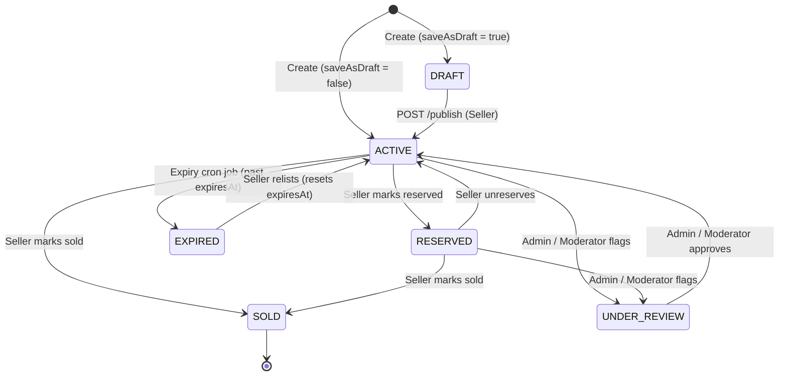

# CampusX 🎓🛒

> **AI-Powered University Marketplace**  
> A trusted, student-verified peer-to-peer commerce and resource exchange platform built for campus communities.

---

## 📌 Project Overview

**CampusX** solves the fragmentation, security, and trust deficits of general public marketplaces (Facebook Marketplace, Craigslist, Reddit) by restricting commerce and exchange to verified university students, faculty, and campus organizations. Students can securely buy, sell, rent, and trade textbooks, electronics, dorm essentials, lab equipment, and subleases within their verified campus network.

### Key Pillars
- **Campus Trust Boundary**: University email (.edu) authentication and student verification.
- **AI-Powered Intelligence**: Automatic item categorization, pricing recommendations based on condition, AI-driven visual similarity search, and automated fraud/content moderation.
- **Modular Monolith Backend**: Clean Node.js + Express backend modularized by domain with Prisma ORM and PostgreSQL.
- **Dedicated AI Microservice**: Fast, isolated Python FastAPI microservice handling vector embeddings, pricing intelligence, and vision tasks.
- **Production-Ready Foundation**: Containerized via Docker Compose, strict security middlewares (CORS whitelisting, Helmet, rate limiting, XSS sanitization, request validation), and continuous integration via GitHub Actions.

---

## 🗺️ 20-Day Engineering Roadmap

| Day | Focus Area | Status | Key Deliverables |
|:---:|:---|:---:|:---|
| **Day 1** | **Project Foundation & Architecture** | ✅ Done | Monorepo layout, Express modular monolith, Prisma + PostgreSQL, React + Vite + Tailwind frontend, FastAPI AI skeleton, Docker containerization, GitHub Actions CI, and `/health` endpoints. |
| **Day 2** | **Authentication & Role-Based Access Control** | ✅ Done | JWT access tokens (15m), opaque refresh tokens (SHA-256 hashed, 7d) in httpOnly cookie with rotation + reuse detection, bcrypt (12 rounds), RBAC (`STUDENT`, `MODERATOR`, `ADMIN`), admin role management, seed script, Zustand in-memory auth store & Axios refresh interceptor. |
| **Day 3** | **Student Verification & User Profiles** | ✅ Done | College email domain whitelist + 6-digit SHA-256 OTP verification (`Nodemailer` / dev console), `requireVerifiedStudent` middleware, profile CRUD with bio XSS sanitization, avatar upload (`multer` + magic-byte validation), public profile endpoint, verified badge UI. |
| **Day 4** | **Marketplace Core: Listings, Categories, Conditions & Lifecycle** | ✅ Done | `Category` & `Product` Prisma models + idempotent category seed, Draft/Publish workflow (`requireVerifiedStudent`), central lifecycle state machine (`DRAFT`, `ACTIVE`, `RESERVED`, `SOLD`, `EXPIRED`, `UNDER_REVIEW`), soft-delete, view counting, moderator review hook, hourly expiry cron (`node-cron`), and Marketplace/Sell/Detail/My Listings UI. |
| **Day 5** | **Product Images & Cloud Storage** | 🚧 In Progress | S3-compatible storage abstraction (`MinIO` / AWS S3 / R2), `sharp` optimization pipeline (magic bytes, EXIF/GPS strip, 3 WebP variants + blur placeholder), `ProductImage` & `avatarKey` migration, presigned/CDN URLs, multi-image uploader, gallery & lightbox UI. |
| **Day 6** | **Campus Search & Filtering Engine** | ⏳ Planned | Full-text indexing, campus filtering, category filters, price range sliders, condition filters. |
| **Day 7** | **AI Service: Auto-Categorization & Tagging** | ⏳ Planned | FastAPI text processing, zero-shot/embedding-based category prediction, auto-tagging of item condition and academic course codes. |
| **Day 8** | **AI Service: Price Recommendation Engine** | ⏳ Planned | Pricing algorithms analyzing historical campus transactions, MSRP depreciation models, fair-market price badges. |
| **Day 9** | **Real-Time Buyer-Seller Messaging** | ⏳ Planned | WebSocket / Socket.io architecture, instant direct messaging, chat history persistence, unread badge counts. |
| **Day 10** | **In-App & Email Notifications** | ⏳ Planned | Event-based notifications for new messages, price drops on saved items, offer updates, and university email alerts. |
| **Day 11** | **Offer Negotiation & Escrow/Hold System** | ⏳ Planned | Formal offer workflow (Make Offer, Counter, Accept, Decline), campus meeting-point suggestions, hold timer before re-listing. |
| **Day 12** | **Trust, Reviews & Reputation Scores** | ⏳ Planned | Post-transaction review system, 5-star ratings, verified transaction badges, anti-fraud community reporting flags. |
| **Day 13** | **Redis Caching & Performance Layer** | ⏳ Planned | Redis caching for hot marketplace listings, user session storage, distributed rate limiting with Redis store. |
| **Day 14** | **Event-Driven Architecture with Kafka** | ⏳ Planned | Kafka event bus for async events: `listing.created`, `offer.accepted`, `user.registered`, audit logging, and search index updates. |
| **Day 15** | **AI Service: Visual Search & Duplicate Detection** | ⏳ Planned | Vector search using CLIP image embeddings, "find similar items" visual search, duplicate listing prevention. |
| **Day 16** | **Content Safety & Moderation Pipeline** | ⏳ Planned | Automated scanning for prohibited items (weapons, drugs, unauthorized exam materials), profanity masking, admin moderation dashboard. |
| **Day 17** | **Observability, Telemetry & Logging** | ⏳ Planned | Prometheus metrics exporter (`/metrics`), Grafana dashboard provisioning, structured Pino logging with trace IDs. |
| **Day 18** | **Testing & Performance Benchmarking** | ⏳ Planned | End-to-end integration test suites (Supertest, Jest, Playwright), k6 load testing for peak campus back-to-school traffic. |
| **Day 19** | **Hardening & Security Audits** | ⏳ Planned | OWASP Top 10 compliance audit, database connection pooling tuning, secrets rotation strategy, production Docker builds. |
| **Day 20** | **Campus Launch Readiness & Demo** | ⏳ Planned | Staging dry-run, seed data generator for university campuses, API documentation (Swagger/OpenAPI), launch checklist. |

---

## 📂 Folder Structure

The repository is organized as a clean, decoupled monorepo:

```text
campusx/
├── .github/
│   └── workflows/
│       └── ci.yml               # GitHub Actions CI (lint, build, test for all services)
├── ai-service/                  # Python FastAPI microservice
│   ├── app/
│   │   ├── __init__.py
│   │   ├── config.py            # Pydantic environment configuration
│   │   └── main.py              # FastAPI app definition with /health endpoint
│   ├── .env.example             # AI Service environment sample
│   ├── .gitignore
│   └── requirements.txt         # FastAPI, Uvicorn, Pydantic dependencies
├── client/                      # React + Vite + Tailwind CSS frontend
│   ├── src/
│   │   ├── components/          # Reusable UI (Navbar, Badges, ProtectedRoute, RoleRoute, HealthCard)
│   │   ├── hooks/               # Custom React hooks (useHealth)
│   │   ├── pages/               # Views (Landing, Login, Signup, Dashboard, Verify, Profile, PublicProfile, Marketplace, ProductDetail, Sell, MyListings)
│   │   ├── services/            # Axios client + 401 refresh interceptor + API wrappers
│   │   ├── store/               # Zustand auth store (in-memory accessToken)
│   │   ├── App.jsx              # Routes & silent refresh bootstrap
│   │   ├── index.css            # Tailwind directives and global styles
│   │   └── main.jsx             # React DOM entrypoint
│   ├── .env.example             # Client environment sample
│   ├── .gitignore
│   ├── index.html               # Vite HTML template
│   ├── package.json             # Frontend dependencies & build scripts
│   ├── postcss.config.js        # PostCSS configuration
│   ├── tailwind.config.js       # Tailwind CSS theme configuration
│   └── vite.config.js           # Vite dev server configuration
├── docker/
│   ├── Dockerfile.ai-service    # Python 3.11 slim container build
│   ├── Dockerfile.client        # Node.js build + Vite preview server
│   └── Dockerfile.server        # Node.js alpine build (runs prisma migrate deploy + seed)
├── server/                      # Node.js + Express Modular Monolith
│   ├── prisma/
│   │   ├── migrations/          # Committed PostgreSQL migrations (Days 2–4)
│   │   ├── schema.prisma        # User, RefreshToken, EmailOtp, Category, Product models
│   │   └── seed.js              # Idempotent ADMIN user & 10 marketplace categories seed
│   ├── src/
│   │   ├── config/              # Environment loader & Prisma DB client singleton
│   │   ├── jobs/                # Hourly listing expiry cron job (node-cron)
│   │   ├── middleware/          # Auth/RBAC, requireVerifiedStudent, Security (Helmet, CORS, Rate Limit, XSS), Validator, Error handler
│   │   ├── modules/             # Domain modules:
│   │   │   ├── admin/           # Admin user management & product moderation hook
│   │   │   ├── auth/            # Signup, login, refresh rotation + reuse detection, logout
│   │   │   ├── categories/      # Public categories endpoint
│   │   │   ├── health/          # Service & DB healthcheck
│   │   │   ├── products/        # Draft/Publish CRUD, lifecycle transitions, soft-delete, views
│   │   │   ├── users/           # Profiles, XSS bio sanitization, magic-byte avatar upload
│   │   │   └── verification/    # College domain check + 6-digit SHA-256 OTP flow
│   │   ├── utils/               # Logger (Pino), Mailer (Nodemailer), XSS sanitizer, AppError, responses
│   │   ├── app.js               # Express application setup (exported for tests)
│   │   └── index.js             # Server bootstrap, expiry cron & graceful shutdown
│   ├── tests/                   # Jest + Supertest suites (health, auth, verification, users, products)
│   ├── .env.example             # Server environment sample
│   ├── .gitignore
│   └── package.json             # Express dependencies, Prisma, Jest scripts
├── scripts/
│   ├── create-issues.ps1        # PowerShell script to automate Day 1 GitHub issues
│   └── create-issues.sh         # Bash script to automate Day 1 GitHub issues
├── .env.example                 # Root environment template for Docker Compose
├── .gitignore                   # Root gitignore
├── docker-compose.yml           # Multi-container orchestration (PostgreSQL, Server, Client, AI)
└── README.md                    # Project documentation
```

---

## 🚀 Quick Start Guide

### Prerequisites
- [Docker & Docker Compose](https://www.docker.com/) (recommended)
- [Node.js](https://nodejs.org/) (v20+ or v24+) & npm (v10+)
- [Python](https://www.python.org/) (3.11+)

### Option A: Run with Docker Compose (Recommended)

1. **Clone the repository and switch to the branch:**
   ```bash
   git clone https://github.com/SARTHAK-KAPOOR17/CampusX.git
   cd CampusX
   git checkout feature/day-1-foundation
   ```

2. **Copy the root environment file:**
   ```bash
   cp .env.example .env
   ```

3. **Start all services in Docker:**
   ```bash
   docker compose up --build
   ```

4. **Verify running containers:**
   | Service | URL | Health Check Endpoint |
   |:---|:---|:---|
   | **Client** | `http://localhost:5173` | UI loads and queries Server Health |
   | **Server API** | `http://localhost:5000` | `http://localhost:5000/api/health` |
   | **AI Microservice** | `http://localhost:8000` | `http://localhost:8000/health` |
   | **PostgreSQL DB** | `localhost:5432` | `pg_isready -U campusx_user -d campusx_db` |

---

### Option B: Run Locally for Development

#### 1. Database (PostgreSQL)
Start PostgreSQL locally on port 5432, or launch just the DB via docker:
```bash
docker compose up -d postgres
```

#### 2. Backend Server
```bash
cd server
cp .env.example .env
npm install
npx prisma generate
npm run dev
```
Runs on `http://localhost:5000`. Test health: `curl http://localhost:5000/api/health`.

#### 3. Frontend Client
```bash
cd client
cp .env.example .env
npm install
npm run dev
```
Runs on `http://localhost:5173`. Open in your browser.

#### 4. AI Microservice
```bash
cd ai-service
cp .env.example .env
python -m venv venv
# Windows:
.\venv\Scripts\activate
# Linux/Mac:
source venv/bin/activate
pip install -r requirements.txt
uvicorn app.main:app --host 0.0.0.0 --port 8000 --reload
```
Runs on `http://localhost:8000`. Test health: `curl http://localhost:8000/health`.

---

## 🧪 Testing

Run backend tests using Jest & Supertest:
```bash
cd server
npm test
```

---

## 🔐 Auth API

All authentication endpoints are mounted under `/api/auth` (and RBAC admin endpoints under `/api/admin`). Refresh tokens are issued as `httpOnly`, `SameSite=Strict` (`Secure` in production) cookies, while short-lived JWT access tokens (15m) are returned in JSON and held in memory only on the client.

| Method | Endpoint | Access | Rate Limit | Description |
|:---:|:---|:---|:---:|:---|
| `POST` | `/api/auth/signup` | Public | Strict | Register a new `STUDENT` user (validates name, email, password strength; bcrypt 12 rounds). |
| `POST` | `/api/auth/login` | Public | Strict | Authenticate user; returns `accessToken` + user profile and sets refresh token cookie. |
| `POST` | `/api/auth/refresh` | Cookie (`refreshToken`) | Strict | Rotate refresh token and issue new token pair. Revokes all user tokens on reuse detection. |
| `POST` | `/api/auth/logout` | Cookie (`refreshToken`) | Standard | Revoke the active refresh token and clear the cookie. |
| `POST` | `/api/auth/logout-all` | Bearer JWT | Standard | Revoke all active refresh tokens for the authenticated user and clear cookie. |
| `GET` | `/api/auth/me` | Bearer JWT | Standard | Return the authenticated user's profile (excludes `passwordHash`). |
| `GET` | `/api/admin/users` | `ADMIN`, `MODERATOR` | Standard | List users with pagination (`?page=1&limit=10`), excluding `passwordHash`. |
| `PATCH` | `/api/admin/users/:id/role` | `ADMIN` only | Standard | Update a user's role (`STUDENT`, `MODERATOR`, `ADMIN`). Blocks self-demotion. |

---

## 🎓 Verification API

Student verification endpoints are mounted under `/api/verification` (authenticated users only).

| Method | Endpoint | Access | Rate / Abuse Controls | Description |
|:---:|:---|:---|:---|:---|
| `POST` | `/api/verification/request` | Bearer JWT | 60s resend cooldown; max 5 requests/hour/user | Validates `collegeEmail` domain against `ALLOWED_COLLEGE_DOMAINS`, checks uniqueness, generates 6-digit `crypto.randomInt` OTP (SHA-256 hashed, 10m expiry), invalidates older OTPs, sends via Nodemailer (or logs to console in dev if SMTP unconfigured). |
| `POST` | `/api/verification/confirm` | Bearer JWT | Max 5 wrong attempts/OTP; constant-time check | Verifies OTP, marks `isVerifiedStudent = true`, sets `verifiedAt` & `collegeEmail` on `User`, and marks OTP consumed. |
| `GET` | `/api/verification/status` | Bearer JWT | Standard | Returns `{ isVerifiedStudent, collegeEmail, verifiedAt }`. |

---

## 👤 Profile API

Profile endpoints are mounted under `/api/users`. Avatars are stored locally in `server/uploads/avatars` (to be migrated to cloud storage on Day 5).

| Method | Endpoint | Access | Description |
|:---:|:---|:---|:---|
| `GET` | `/api/users/me/profile` | Bearer JWT | Fetch the authenticated user's full profile (excluding `passwordHash`). |
| `PATCH` | `/api/users/me/profile` | Bearer JWT | Update `name`, `course`, `branch`, `year` (1–6), and `bio` (max 300 chars, XSS-sanitized). |
| `POST` | `/api/users/me/avatar` | Bearer JWT | Upload avatar (`multipart/form-data`, field `avatar`, max 2MB, JPEG/PNG/WebP verified by magic bytes); replaces & deletes previous avatar. |
| `GET` | `/api/users/:id` | Public | Fetch sanitized public profile (`id`, `name`, `profilePictureUrl`, `course`, `branch`, `year`, `bio`, `ratingAverage`, `ratingCount`, `isVerifiedStudent`). Never exposes `email`, `collegeEmail`, `role`, or `passwordHash`. |

---

## 🛒 Marketplace API

Categories and product listings are mounted under `/api/categories`, `/api/products`, and `/api/admin/products`. Soft-deleted listings (`deletedAt != null`) are excluded from all queries.

| Method | Endpoint | Access | Description |
|:---:|:---|:---|:---|
| `GET` | `/api/categories` | Public | List all seeded marketplace categories sorted alphabetically by `name`. |
| `GET` | `/api/products` | Public | Paginated feed (`?page=1&limit=12&categoryId=`) of `ACTIVE` and `RESERVED` listings sorted newest first, including seller public info. |
| `GET` | `/api/products/mine` | Bearer JWT | List the authenticated seller's own listings with optional `?status=` filter. |
| `GET` | `/api/products/:id` | Public / Optional Auth | View listing details (`DRAFT`, `UNDER_REVIEW`, `EXPIRED` visible only to owner, `ADMIN`, `MODERATOR`). Increments `viewCount` for non-owners. |
| `POST` | `/api/products` | Bearer JWT + Verified Student | Create a listing (`saveAsDraft: true` requires only `title`; publishing requires `title`, `description`, `price`, `categoryId`, `condition` and sets `expiresAt = now + LISTING_EXPIRY_DAYS`). |
| `PATCH` | `/api/products/:id` | Owner only | Edit listing fields (allowed only in `DRAFT`, `ACTIVE`, or `RESERVED`). |
| `POST` | `/api/products/:id/publish` | Owner only | Publish a `DRAFT` listing (`DRAFT -> ACTIVE`), setting `publishedAt` and `expiresAt`. |
| `POST` | `/api/products/:id/status` | Owner only | Transition seller listing status (`ACTIVE <-> RESERVED`, `ACTIVE/RESERVED -> SOLD`, `EXPIRED -> ACTIVE` relist). |
| `DELETE` | `/api/products/:id` | Owner or `ADMIN` | Hard delete for `DRAFT` listings; soft delete (`deletedAt`) for all other statuses. |
| `PATCH` | `/api/admin/products/:id/status` | `ADMIN`, `MODERATOR` | Moderation transition (`ACTIVE/RESERVED -> UNDER_REVIEW` or `UNDER_REVIEW -> ACTIVE`). |

---

## 🔄 Listing Lifecycle

Allowed listing status transitions enforced centrally in the product service (plus automated hourly expiry via `node-cron`):



---

## 🖼️ Storage & Images

### Architecture
CampusX decouples image processing from object storage using a provider-agnostic S3 interface (`server/src/services/storage/`) backed by `@aws-sdk/client-s3` and `@aws-sdk/s3-request-presigner`. Locally, Docker Compose runs **MinIO** on `:9000` (API) and `:9001` (Web Console) with a **private** bucket (`campusx-media`). On startup in development, the server ensures the bucket exists; in production, it fails fast if storage is unreachable.

### Upload & Optimization Flow
1. **Multipart Ingestion**: `multer` (memory storage, 5MB limit) + strict upload rate limiting (`uploadLimiter`).
2. **Magic-Byte & Decompression-Bomb Guard**: `sharp` + binary signature checks accept only genuine `JPEG`, `PNG`, and `WebP` files (`limitInputPixels` enforced).
3. **Privacy & Optimization**: Strips all EXIF/GPS metadata, auto-rotates via orientation, and generates 3 WebP variants (`thumb`: 320px, `medium`: 800px, `large`: 1600px, never upscaling) plus a ~20px base64 `blurDataUrl`.
4. **Private Bucket Storage**: Objects are uploaded concurrently under random UUID keys — never user-supplied filenames.
5. **URL Signing**: API responses return short-lived presigned `GET` URLs (`SIGNED_URL_EXPIRY_SECONDS`, default `900`s) computed locally in CPU (no per-image network calls), or `CDN_BASE_URL` URLs when a CDN is configured.

### Bucket Key Layout
```text
campusx-media/
├── products/
│   └── {productId}/
│       └── {imageId}/
│           ├── thumb.webp      (320px wide)
│           ├── medium.webp     (800px wide)
│           └── large.webp      (1600px wide)
└── avatars/
    └── {userId}/
        └── {imageId}/
            ├── thumb.webp      (320px wide)
            ├── medium.webp     (800px wide)
            └── large.webp      (1600px wide)
```

### Switching from MinIO to AWS S3 or Cloudflare R2
No application code changes are required — only environment variables:

```env
# AWS S3 Example
STORAGE_ENDPOINT=https://s3.ap-south-1.amazonaws.com
STORAGE_REGION=ap-south-1
STORAGE_BUCKET=campusx-prod-media
STORAGE_ACCESS_KEY=<IAM_ACCESS_KEY>
STORAGE_SECRET_KEY=<IAM_SECRET_KEY>
STORAGE_FORCE_PATH_STYLE=false
CDN_BASE_URL=https://cdn.campusx.edu   # Optional CloudFront/Cloudflare CDN

# Cloudflare R2 Example
STORAGE_ENDPOINT=https://<ACCOUNT_ID>.r2.cloudflarestorage.com
STORAGE_REGION=auto
STORAGE_BUCKET=campusx-prod-media
STORAGE_ACCESS_KEY=<R2_ACCESS_KEY>
STORAGE_SECRET_KEY=<R2_SECRET_KEY>
STORAGE_FORCE_PATH_STYLE=true
```

---

## 🔒 Security Architecture
- **Helmet**: Secures HTTP response headers against clickjacking, sniffing, and XSS.
- **CORS Whitelist**: Whitelists only trusted origins defined in `CORS_ORIGIN`.
- **Express Rate Limit**: Prevents brute-force and DoS attacks (default 100 requests per 15 minutes per IP).
- **XSS Sanitization**: Strips dangerous script injections from request body, query, and params.
- **Request Body Limits**: Enforces strict payload limits (default 10MB) to mitigate memory exhaustion.
- **Standardized JSON Envelope**: Uniform API responses with `success`, `statusCode`, `message`, `data`, and `timestamp`.

---

## 📄 License
ISC © 2026 CampusX Engineering Team
