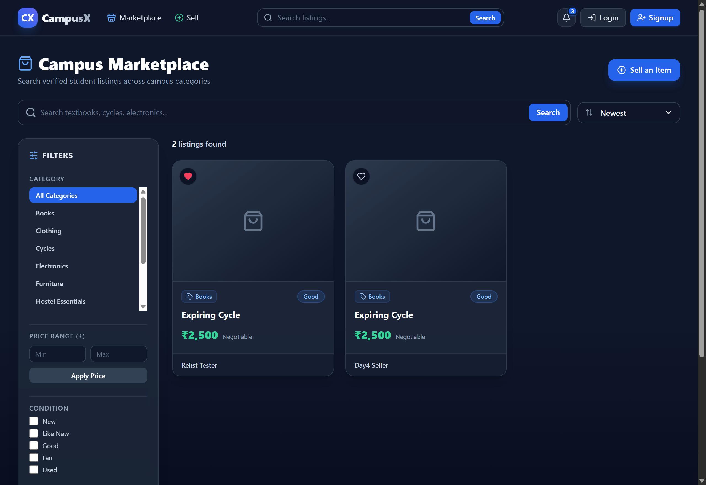
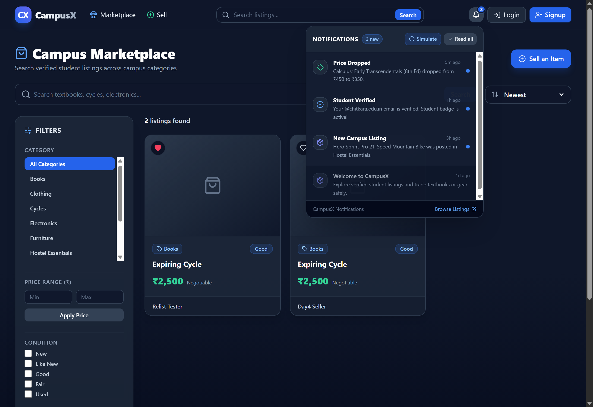
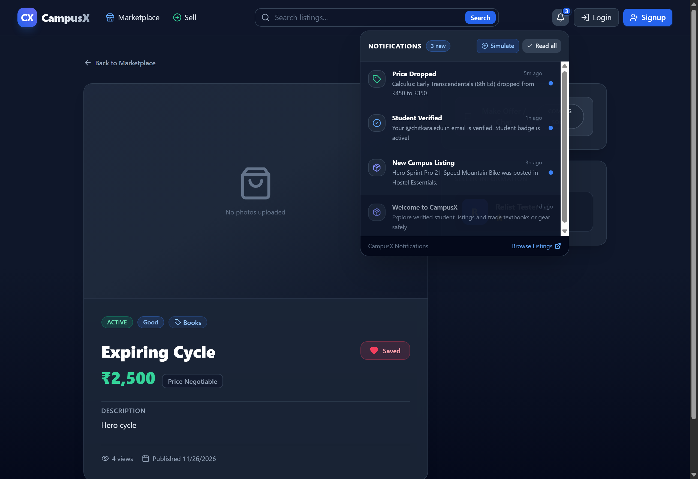
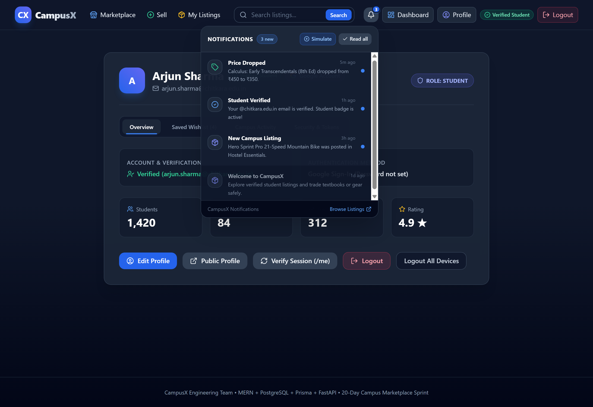
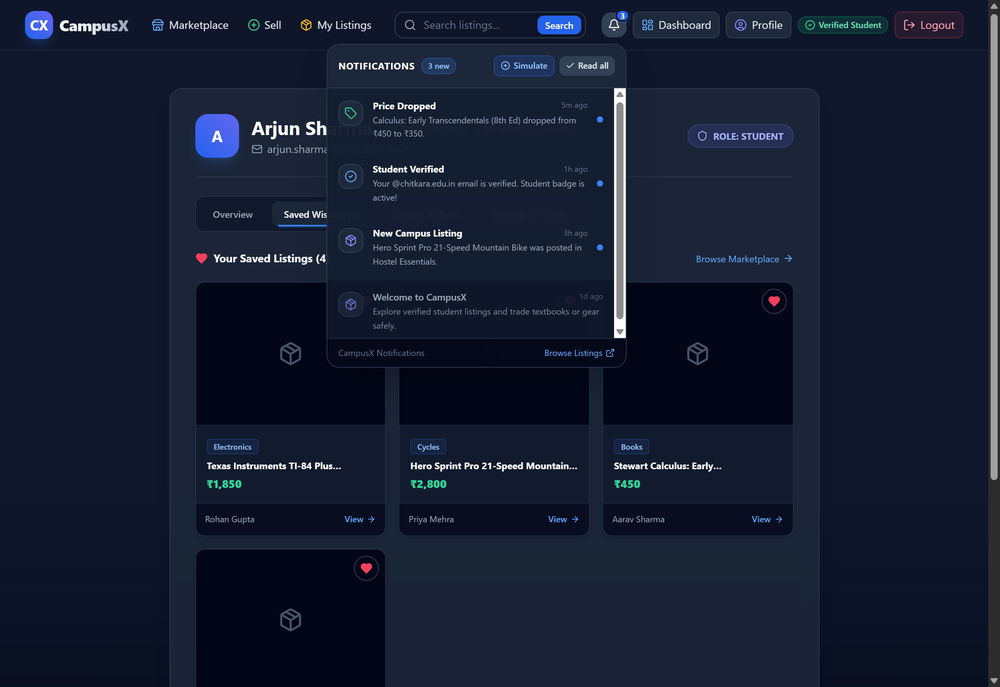
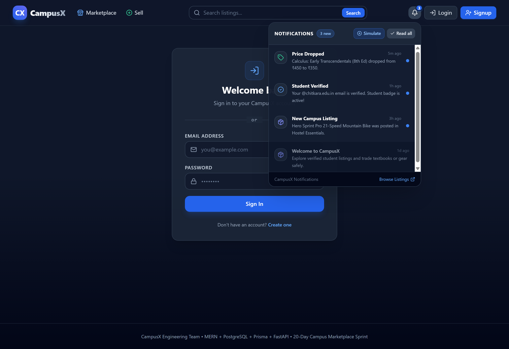

# CampusX Feature Showcase & UI Animations

This document showcases the CampusX frontend features and animations implemented using Framer Motion (`LazyMotion`, `domAnimation`, `MotionConfig reducedMotion="user"`, transform/opacity only, 150–300ms duration, and zero layout shift).

---

## 📸 Feature Screenshots

### 1. Campus Marketplace Grid
- **File**: [`docs/screenshots/01-marketplace-grid.png`](./screenshots/01-marketplace-grid.png)
- **Features**: Responsive product listing grid, real-time search autocomplete, category chips, condition filters, and instant wishlist heart toggles.
- **Animations**: First-load staggered entrance (`staggerContainer` + `staggerItem`), card hover lift (`whileHover: { y: -4 }`), and skeleton shimmer loading state.

---

### 2. Wishlist Heart Pop & Fill Transition
- **File**: [`docs/screenshots/02-wishlist-heart-pop.png`](./screenshots/02-wishlist-heart-pop.png)
- **Features**: Interactive bookmarking for student listings. Wishlist state is synchronized across the marketplace, product detail view, and student dashboard.
- **Animations**: Quick scale "pop" (`scale: [0.8, 1.25, 1]`, duration 250ms) and smooth fill transition (`transition-colors duration-200 fill-rose-500 text-rose-500`).

---

### 3. Notification Bell with Badge Pop & Animated Dropdown
- **File**: [`docs/screenshots/03-notification-bell-dropdown.png`](./screenshots/03-notification-bell-dropdown.png)
- **Features**: Real-time notifications for price drop alerts, student verification approval, campus meetups, and buyer offers. Includes simulated alert trigger for instant live testing.
- **Animations**:
  - Badge unread count pop: `scale: [0.8, 1.35, 1]` with spring physics on count change.
  - Dropdown menu: `slideDown` entrance (`y: -8 -> 0`, `opacity: 0 -> 1`) and exit animation with `<AnimatePresence>`.
  - Notifications list: Staggered fade-in on first load only (`staggerContainer` + `staggerItem`).

---

### 4. Product Detail Page & Image Gallery
- **File**: [`docs/screenshots/04-product-detail.png`](./screenshots/04-product-detail.png)
- **Features**: Full-resolution image zoom, condition badges, seller verification status, price negotiation tag, and persistent wishlist toggle.
- **Animations**: Crossfade image transition, heart pop spring, and tap feedback (`whileTap: { scale: 0.98 }`).

---

### 5. Google Sign-In & Authentication
- **File**: [`docs/screenshots/05-login-google-signin.png`](./screenshots/05-login-google-signin.png)
- **Features**: Official Google Identity Services (GIS) button with client-side credential verification alongside traditional student email/password login.
- **Animations**: Smooth error banner slide-down (`slideDown`), button tap feedback, and route transition fading.

---

### 6. Student Dashboard: Animated Stat Counters & Sliding Tab Underline
- **File**: [`docs/screenshots/06-dashboard-animated-stats.png`](./screenshots/06-dashboard-animated-stats.png)
- **Features**: Overview of university account status, active session verification (`GET /api/auth/me`), and live marketplace performance metrics.
- **Animations**:
  - Stat-card count-up: Smooth 600ms count-up utilizing `AnimatedCounter.jsx` (respects `prefers-reduced-motion`).
  - Sliding tab underline: Shared layout animation via `<m.div layoutId="activeTabUnderline" />` smoothly sliding under the active navigation tab.

---

### 7. Dashboard Saved Wishlist (First-Load Stagger)
- **File**: [`docs/screenshots/07-dashboard-saved-wishlist.png`](./screenshots/07-dashboard-saved-wishlist.png)
- **Features**: Dedicated wishlist view inside student dashboard displaying all saved listings with quick-action links and remove buttons.
- **Animations**: Staggered fade-in on first load only (`staggerContainer` + `staggerItem`), preserving rendering performance on repeated tab switches.

---

### 8. User Profile & College Verification Badge
- **File**: [`docs/screenshots/08-user-profile.png`](./screenshots/08-user-profile.png)
- **Features**: Student profile management, university domain badge (`@chitkara.edu.in`), Google OAuth badge, and role indicator.
- **Animations**: Verification checkmark spring pop, profile edit modal transitions, and route animations.

---

## 🎨 Motion Design Architecture

All animations adhere to the core CampusX performance guidelines:
1. **GPU Acceleration Only**: Strictly animate `transform` (`translate`, `scale`, `rotate`) and `opacity`. Zero animation on layout properties (`width`, `height`, `margin`, `padding`).
2. **Snappy Timing**: Micro-interactions range from 150ms to 200ms; complex modals and drawers complete in 250ms–300ms.
3. **Accessibility**: Wrapped in `<MotionConfig reducedMotion="user">` to automatically disable motion when users have `prefers-reduced-motion: reduce` enabled in their operating system.
